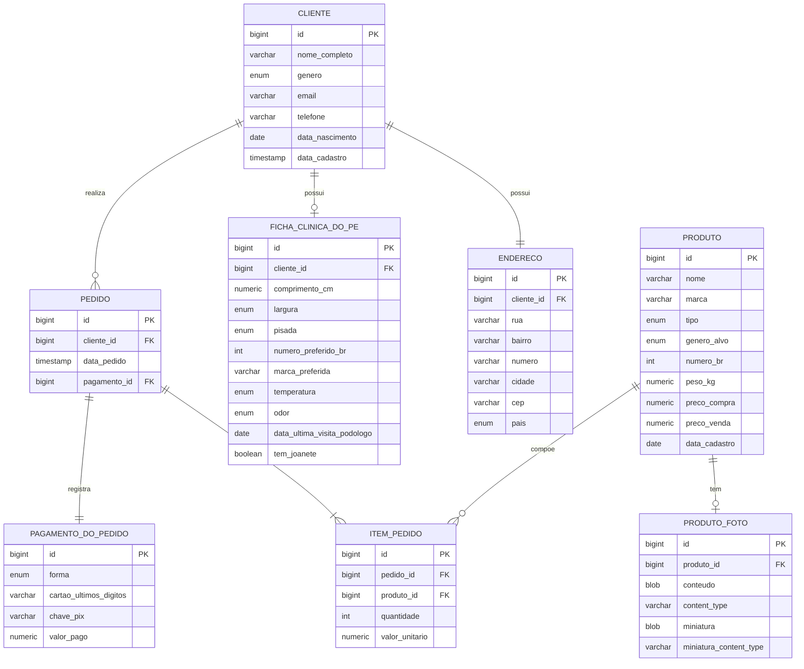

# MER - modelo entidade-relacionamento do PéFrioShop

Diagrama gerado a partir das entidades JPA. É o esquema que o Hibernate cria no
banco, com as chaves, os tipos e as relações.

## Relações e cardinalidades

| Relação | Cardinalidade | Regra |
|---|---|---|
| Cliente e endereço | 1 para 1 | Cada cliente tem um endereço, em tabela própria. Excluir o cliente exclui o endereço. |
| Cliente e ficha clínica | 1 para 0 ou 1 | Cada cliente tem no máximo uma ficha. Excluir o cliente exclui a ficha em cascata. |
| Cliente e pedido | 1 para 0 ou muitos | Excluir o cliente não é permitido enquanto houver pedido. |
| Pedido e item | 1 para 1 ou muitos | Excluir o pedido exclui os itens em cascata. |
| Pedido e pagamento | 1 para 1 | Cada pedido tem um pagamento. Excluir o pedido exclui o pagamento. |
| Produto e foto | 1 para 0 ou 1 | A foto fica em tabela própria. Excluir o produto exclui a foto. |
| Produto e item | 1 para 0 ou muitos | Excluir o produto não é permitido enquanto houver item. Excluir o pedido não afeta o produto. |

## Observações

- O endereço tem tabela e identidade próprias, com a chave estrangeira
  `cliente_id` única. Assim, campos como `pais` entram sem inchar a linha do
  cliente.
- O campo `pais` é um enum, e não texto livre, para evitar grafias divergentes.
- A foto do produto fica em `produto_foto` para a linha do produto permanecer
  leve; a listagem não carrega os bytes.
- Chaves únicas: `endereco.cliente_id`, `ficha_clinica_do_pe.cliente_id`,
  `produto_foto.produto_id` e `pedido.pagamento_id`.
- O `item_pedido.valor_unitario` é uma cópia do preço no momento da compra, e
  não o preço atual do produto.
- Nenhum valor calculável é guardado: o total do pedido, o imposto e o desconto
  são obtidos em tempo de execução.

## Valores dos enums

| Enum | Valores |
|---|---|
| Genero | MASCULINO, FEMININO, NAO_INFORMADO |
| Pais | BRASIL, PORTUGAL, ESTADOS_UNIDOS, ESPANHA, ARGENTINA, OUTRO |
| TipoProduto | TENIS, SANDALIA, BOTA, SAPATENIS, CHINELO |
| GeneroAlvo | MASCULINO, FEMININO, UNISSEX, INFANTIL |
| LarguraPe | ESTREITO, NORMAL, LARGO |
| TipoPisada | PRONADA, SUPINADA, NEUTRA |
| TemperaturaPe | FRIO, NORMAL, QUENTE |
| OdorPe | SEM_ODOR, LEVE, FORTE |
| FormaPagamento | DINHEIRO, CARTAO_CREDITO, PIX |
